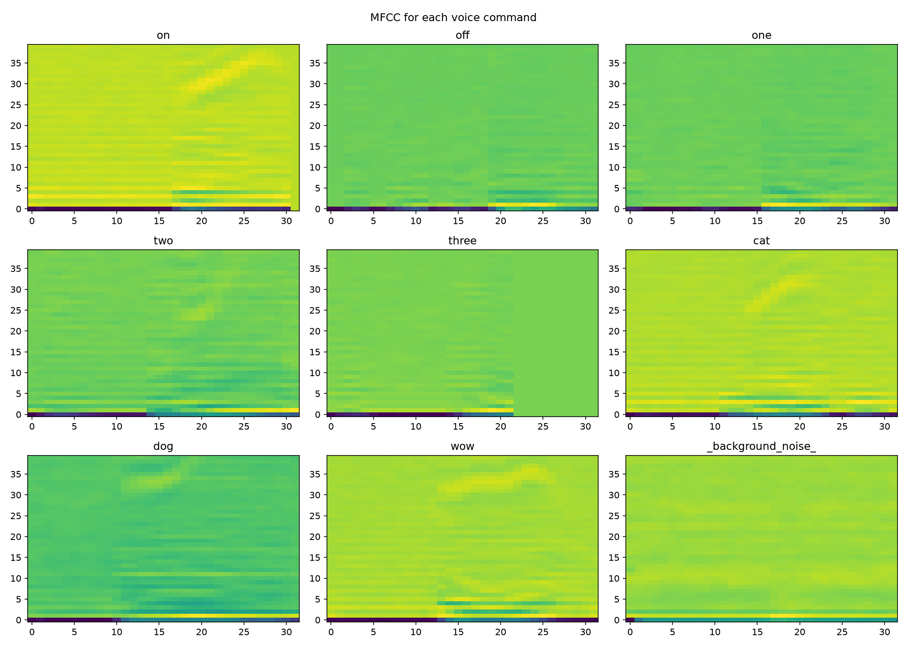
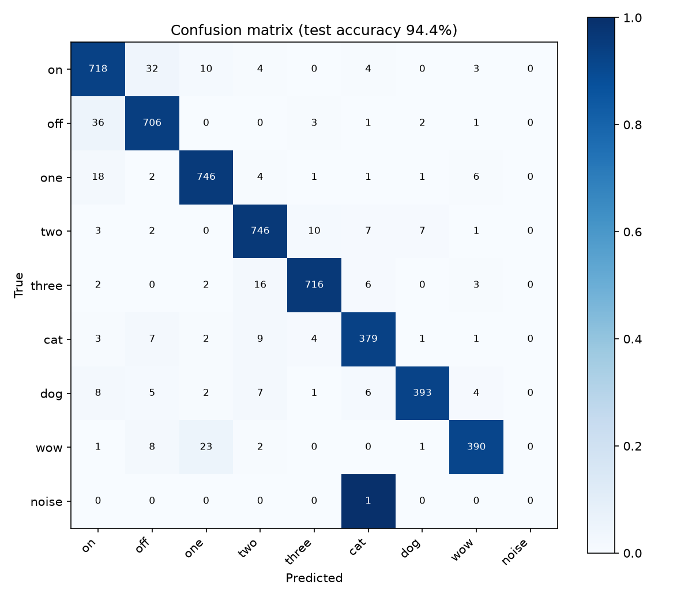
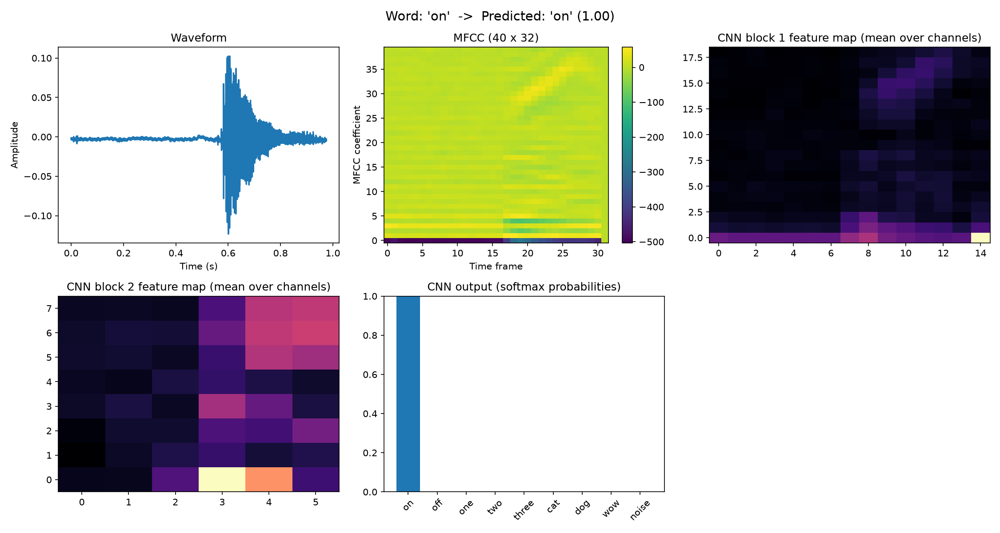

# Voice-Controlled Room Lights (v1.0)

A voice-controlled smart-room demo. A small CNN trained on MFCC features of Google's
Speech Commands dataset recognises spoken words in real time, and a Tkinter GUI uses
them to switch the lights of three rooms on and off.

> **Version 1.0**: the first, basic version, built in my 2nd year of EEE.
> Roadmap: **v1.1** improved GUI, **v2.0** hardware integration (Arduino).



## How it works

1. The microphone is read in 1-second chunks (16 kHz) and silent chunks are skipped.
2. Each chunk is converted to **40 MFCCs x 32 time frames** (librosa).
3. A **CNN** classifies it into 9 classes: `on`, `off`, `one`, `two`, `three`, `cat`, `dog`, `wow`, `background noise`.
4. A prediction is accepted only if its confidence is **>= 0.90**.
5. The GUI reacts to the command:
   - say **"on"**: the three room photos appear (all lights off)
   - say **"one" / "two" / "three"**: toggles the light of that room
   - say **"off"**: returns to the start screen

### CNN architecture
`Conv2D(32) > BatchNorm > MaxPool > Dropout > Conv2D(64) > BatchNorm > MaxPool > Dropout > Flatten > Dense(128) > Dropout > Dense(9, softmax)`

## Results

Evaluated on a held-out 20% test split (5,078 clips, stratified, `random_state=42`).

| Metric | Value |
|---|---|
| Test accuracy (9 classes) | **94.41%** |
| Accuracy at confidence >= 0.90 | **98.36%** (accepts 91.5% of clips) |
| Parameters | 413,705 |
| Model size | 1.70 MB |
| MFCC extraction | 5.5 ms per 1 s clip (CPU) |
| CNN inference | 19.0 ms per clip (CPU) |

Per-class precision, recall and F1 are in [`outputs_metrics/metrics.txt`](outputs_metrics/metrics.txt).



Example output for one command (waveform, MFCC, CNN feature maps, softmax probabilities):



## Run it

Python **3.12** is recommended (TensorFlow does not support the newest Python versions yet).

```
python -m venv venv
venv\Scripts\activate
pip install -r requirements.txt
python GUI_plus_VOICE.py
```

Allow microphone access when asked. Say **"on"** to start.

## Files

| File | Purpose |
|---|---|
| `GUI_plus_VOICE.py` | Main app: live microphone recognition + room-lights GUI |
| `voice_switch_fixed.keras` | Trained CNN model |
| `room1_on.jpg` ... `room3_off.jpg` | Room images used by the GUI |
| `step3_extra_changed.py` | Training script (CNN on MFCCs) |
| `step4_plotforON.py` | Waveform, spectrum, spectrogram and MFCC plots for one word |
| `step5_changedextra.py` | Console version of live word detection (no GUI) |
| `generate_outputs_final.py` | Creates the per-command MFCC / CNN figures in `outputs/` |
| `evaluate_model.py` | Computes accuracy, per-class metrics, confusion matrix and speed |
| `outputs/`, `outputs_metrics/` | Generated figures and metrics |

## Retraining

The dataset is not included in this repository. Download **Speech Commands v0.02**
from the TensorFlow site, copy the folders `on`, `off`, `one`, `two`, `three`, `cat`,
`dog`, `wow` and `_background_noise_` into a folder named `speech_commands_filtered`,
then run:

```
python step3_extra_changed.py
```

## Known limitations (v1.0)

- The **background-noise class is weak**: it was built from only 6 long recordings, so
  only 1 noise clip falls in the test set and its per-class score is not meaningful.
- Audio is processed in fixed 1-second chunks, so a word cut across two chunks may be missed.
- Trained only on the Speech Commands dataset; accuracy with other microphones, accents
  or noisy rooms has not been tested.
- A fixed confidence threshold (0.90) is used instead of a tuned one.

## Roadmap

- **v1.1**: improved GUI, noise handling (many 1-second noise clips), sliding-window detection
- **v2.0**: hardware integration with Arduino-controlled LEDs

## License

MIT, see [LICENSE](LICENSE).
